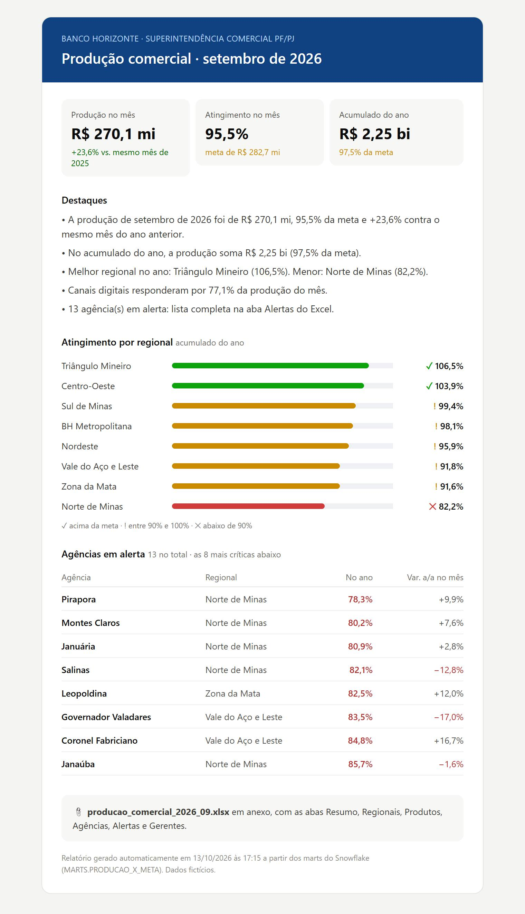

# Automação do relatório de produção comercial

**Relatório gerencial mensal gerado e distribuído sem trabalho manual.** O script lê os marts do warehouse, calcula os indicadores do mês e do ano, aponta as agências em alerta, monta o Excel formatado para a liderança e envia um e-mail executivo com o resumo. Ele roda agendado no GitHub Actions (ou no Agendador de Tarefas do Windows).



> Consome os marts do projeto [painel-producao-comercial](https://github.com/danielpegogomes/painel-producao-comercial) (Banco Horizonte, dados fictícios).

## O que substitui

Antes: exportar a base, montar tabelas dinâmicas, colar no modelo do Excel, formatar, escrever o resumo e mandar o e-mail. Eram horas todo início de mês, com risco de erro de cópia.

Agora: `python -m relatorio`, em **menos de 1 segundo**, sempre no mesmo padrão:

```
17:13:58  INFO    dados carregados: 15006 linhas de produção × meta, 8550 de gerentes
17:13:58  INFO    referência: setembro de 2026 · produção R$ 270,1 mi · 95,5% da meta · 13 agências em alerta
17:13:58  INFO    excel gerado: saida/producao_comercial_2026_09.xlsx
17:13:58  INFO    e-mail salvo em saida/ (use --enviar para disparar por SMTP)
17:13:58  INFO    concluído em 0.7s
```

## Entregas

**Excel** (`saida/producao_comercial_AAAA_MM.xlsx`), gerado com xlsxwriter:

| Aba | Conteúdo |
|---|---|
| Resumo | KPIs do mês e do ano, destaques em texto e gráfico nativo de produção × meta dos últimos 12 meses |
| Regionais | Mês e acumulado, atingimento com semáforo e barras de dados, variação a/a, % digital |
| Produtos | Produção, meta, atingimento e variação por produto |
| Agências | As 57 agências, com filtro automático e painéis congelados |
| Alertas | Agências abaixo do mínimo de atingimento no ano ou com queda forte no mês, com o motivo escrito |
| Gerentes | Top 10 do mês |

**E-mail executivo** em HTML compatível com clientes de e-mail (tabelas e estilos inline), com o Excel anexo: KPIs, destaques, atingimento por regional com status (ícone e texto, não só cor) e a lista das agências em alerta.

## Regras de alerta

Configuráveis em `config.yaml`, sem mexer no código:

```yaml
alertas:
  atingimento_minimo: 0.90     # abaixo de 90% da meta no acumulado do ano
  queda_maxima_aa: -0.05       # ou queda maior que 5% contra o mesmo mês do ano anterior
```

## Agendamento

- **GitHub Actions** (`.github/workflows/relatorio-mensal.yml`): todo dia 2, às 8h (Brasília). Roda os testes, gera o relatório e guarda o Excel e o e-mail como artefato por 90 dias. Também pode ser disparado à mão, com o mês e a opção de envio.
- **Windows** (servidor da área):
  ```bat
  schtasks /Create /TN "Relatorio Producao Comercial" /SC MONTHLY /D 2 /ST 08:00 ^
    /TR "C:\relatorios\.venv\Scripts\python.exe -m relatorio --enviar" /RU SYSTEM
  ```
- Credenciais SMTP só por variáveis de ambiente ou *secrets* (`SMTP_HOST`, `SMTP_PORT`, `SMTP_USER`, `SMTP_PASSWORD`). Nunca no código.

## Como rodar

```bash
python -m venv .venv && source .venv/bin/activate   # Windows: .venv\Scripts\activate
pip install -r requirements.txt

python -m relatorio                  # último mês com dados
python -m relatorio --mes 2026-08    # mês específico
python -m relatorio --enviar         # envia por SMTP
pytest -q
```

## Estrutura

```
├── relatorio/
│   ├── __main__.py      # CLI: carrega, calcula, gera e distribui
│   ├── indicadores.py   # indicadores do mês e do ano, alertas, destaques em texto
│   ├── excel.py         # Excel formatado com gráfico nativo e formatação condicional
│   └── email.py         # e-mail HTML (Jinja2) com anexo; envio por SMTP
├── templates/email.html.j2
├── config.yaml          # fontes, destinatários e limites de alerta
├── dados/               # marts em Parquet (MARTS.PRODUCAO_X_META, MARTS.GERENTES_MENSAL)
└── tests/
```

---

Feito por **Daniel Pego** · [LinkedIn](https://www.linkedin.com/in/danielpegogomes/)
